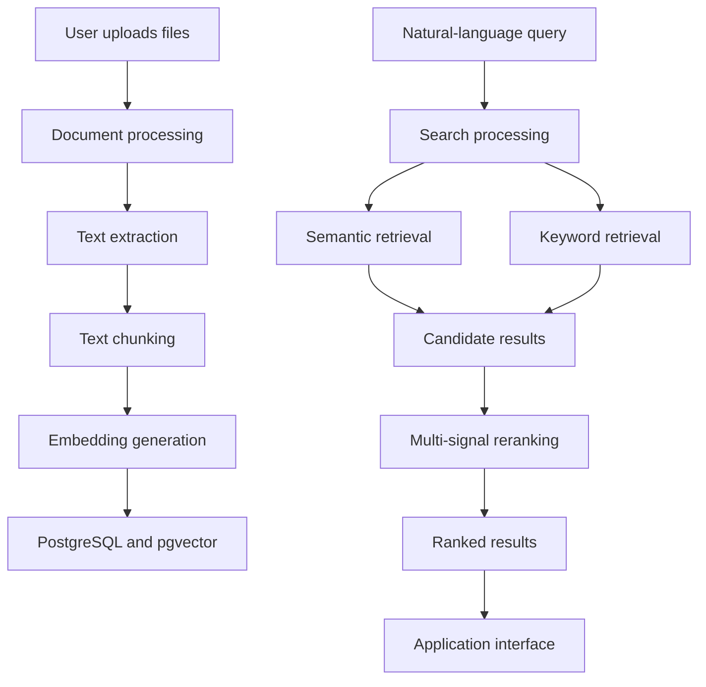
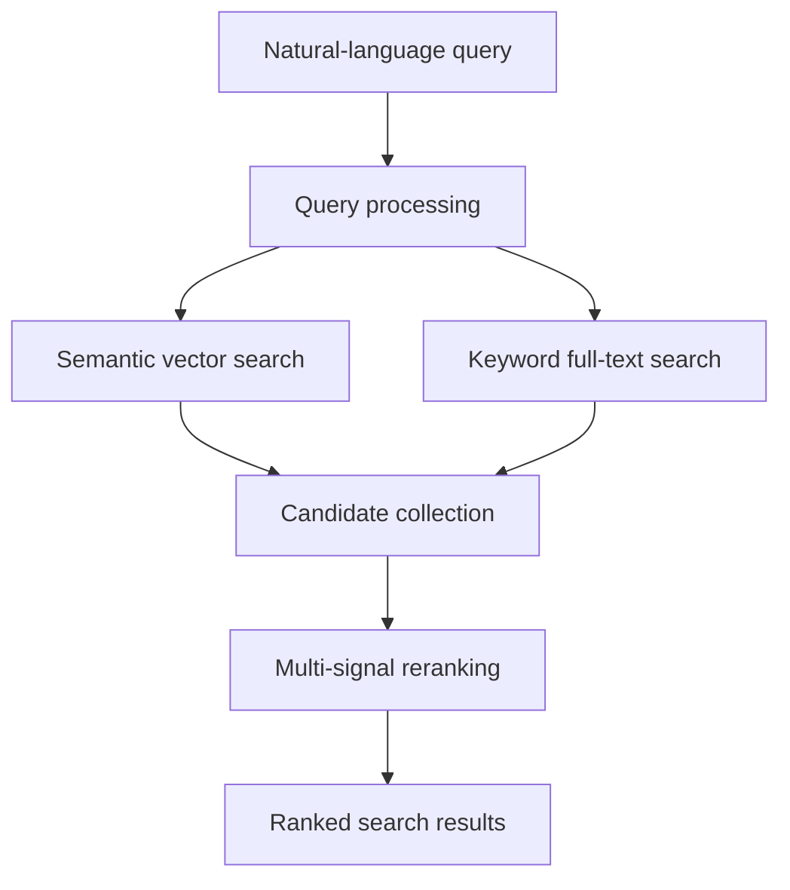
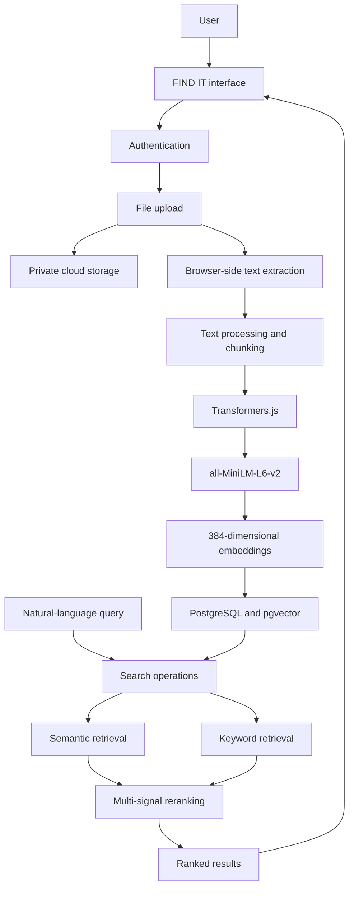
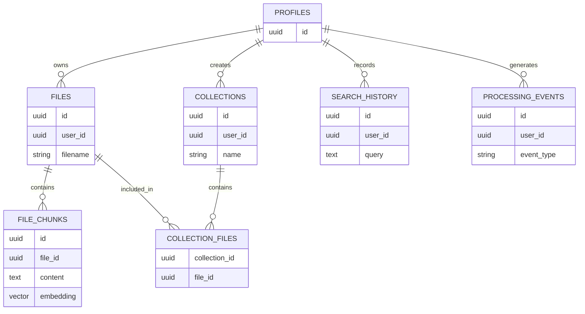
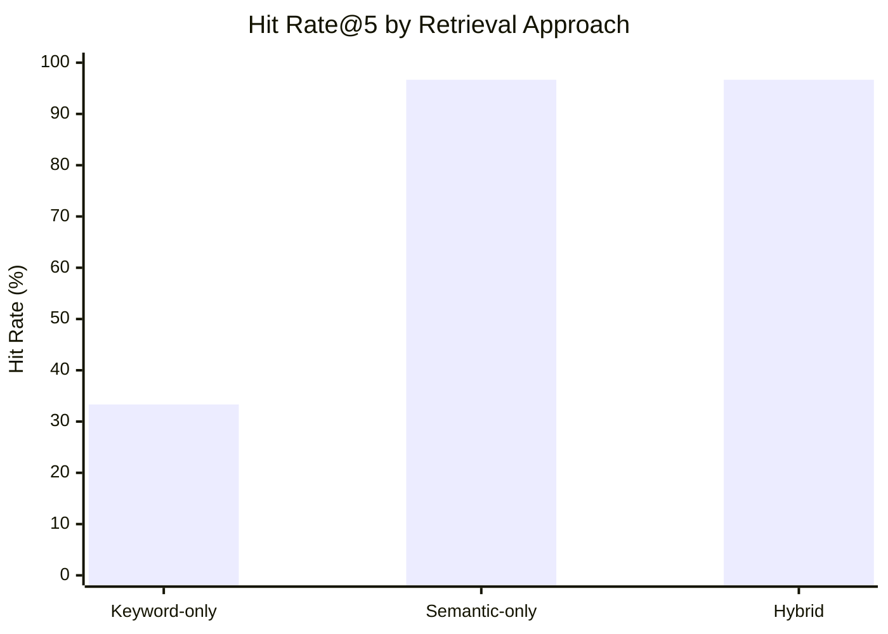
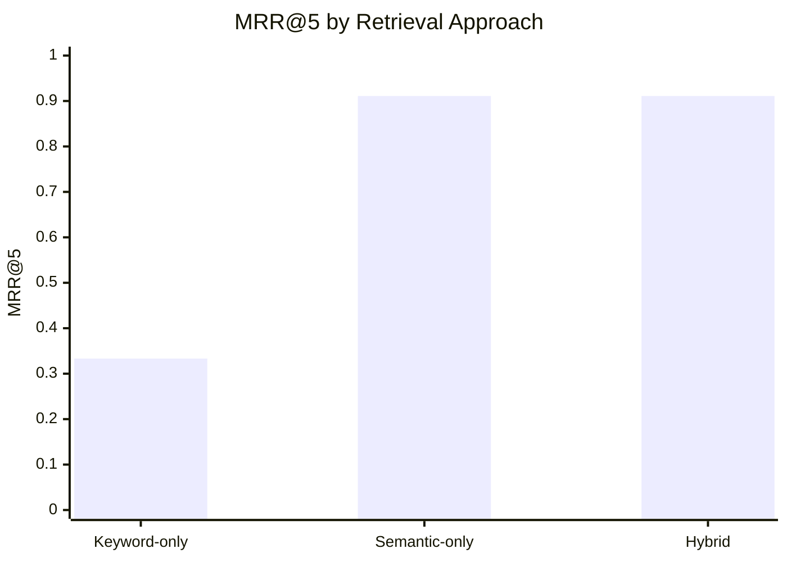
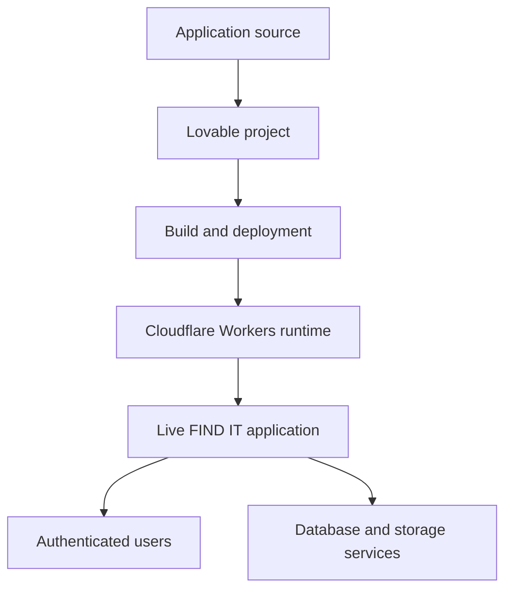

<div align="center">


# FIND IT

### Search by what you remember, not by what you named it.

An AI-powered personal file retrieval application that helps users find documents using natural-language descriptions instead of relying entirely on filenames or exact keywords.

<br/>

<a href="https://ffindit.lovable.app/">

</a>

<br/><br/>


<br/><br/>


<br/><br/>

**Developed by Sumaya Fathima**

**Research Supervisor:** Dr. Samar Mouti

</div>

---

## Table of Contents

1. [Introduction](#1-introduction)
2. [The Problem](#2-the-problem)
3. [The Solution](#3-the-solution)
4. [How FIND IT Works](#4-how-find-it-works)
5. [Key Features](#5-key-features)
6. [Live Application](#6-live-application)
7. [Supported File Formats](#7-supported-file-formats)
8. [Retrieval Approaches](#8-retrieval-approaches)
9. [System Architecture](#9-system-architecture)
10. [Technology Stack](#10-technology-stack)
11. [Database Architecture](#11-database-architecture)
12. [Research Study](#12-research-study)
13. [Experimental Results](#13-experimental-results)
14. [Research Findings](#14-research-findings)
15. [Privacy and Security](#15-privacy-and-security)
16. [Limitations](#16-limitations)
17. [Future Development](#17-future-development)
18. [Project Structure](#18-project-structure)
19. [Development and Testing](#19-development-and-testing)
20. [Deployment](#20-deployment)
21. [Acknowledgements](#21-acknowledgements)
22. [Project Information](#22-project-information)

---

# 1. Introduction

**FIND IT** is an AI-powered personal file retrieval application designed to help users find previously uploaded documents and images using natural-language descriptions rather than relying entirely on filenames or exact keywords.

Users frequently remember what a document contains but forget what they named it.

Traditional file search can become difficult when the vocabulary used in a search query differs from the terminology inside the original document.

FIND IT addresses this problem through a combination of:

- Natural-language search
- Semantic embeddings
- Vector similarity retrieval
- PostgreSQL full-text keyword search
- Hybrid retrieval
- Deterministic multi-signal reranking
- Multi-format document extraction

Instead of remembering a filename, users can describe what they remember about a document.

> You should be able to find a document using what you remember about it, not just what you called it.

# 2. The Problem

Digital information accumulates quickly.

Students collect lecture notes, assignments, presentations, screenshots and research papers. Researchers manage academic papers, references, datasets and supporting documents. Professionals accumulate reports, presentations and work-related files.

Finding a particular document later can become difficult.

### Common Problems

**Forgotten filenames**

Users remember the topic of a document but cannot remember its filename.

**Vocabulary mismatch**

A user may search using different words from those used in the original document.

**Incomplete memories**

Sometimes users remember only a concept, a sentence or a small detail.

**Large document collections**

Manually browsing through folders becomes inefficient as file collections grow.

**Limitations of keyword-based search**

Traditional lexical retrieval depends heavily on matching terms. It can struggle when a query and document express similar ideas using different vocabulary.

### Example

Imagine a student trying to find a document containing information about artificial intelligence and academic productivity.

The original document might contain terminology such as:

- AI-assisted learning
- Academic efficiency
- Intelligent study tools

The student remembers the concept, but not the exact terminology or filename.

FIND IT allows the student to search using a natural-language description.

# 3. The Solution

FIND IT provides a natural-language interface for retrieving previously uploaded documents.

Users upload their files into the application. FIND IT extracts searchable content, generates semantic embeddings and stores the information for subsequent retrieval.

When a user enters a description, the application searches indexed content and ranks relevant results.

### Traditional File Search vs FIND IT

| Traditional File Search | FIND IT |
|---|---|
| Relies heavily on filenames | Supports content-based search |
| Depends on matching terminology | Supports semantic similarity |
| Requires remembered keywords | Accepts natural-language descriptions |
| Manual browsing may be necessary | Returns ranked search results |
| Limited by lexical differences | Combines semantic and keyword retrieval |

### Example Search Queries

- Find my notes about operating system memory management.
- Show me the document discussing AI in education.
- Find the assignment related to database normalization.
- Locate the research document about renewable energy.
- Find the screenshot containing information about an upcoming event.

**Important:** FIND IT searches files that users have uploaded into the application. It does not automatically scan a user's entire laptop or local folders.

# 4. How FIND IT Works

FIND IT follows a document-processing and retrieval workflow.

### Step 1 — Upload

Users upload supported documents and images through the application interface.

Original files are stored in private user-specific cloud storage.

### Step 2 — Extract

The application extracts available text using format-specific processing libraries.

| File Type | Technology |
|---|---|
| PDF | PDF.js |
| DOCX | Mammoth.js |
| Images | Tesseract.js |
| TXT | Direct text extraction |
| Markdown | Direct text extraction |

### Step 3 — Process

Extracted content is processed into searchable text chunks.

### Step 4 — Generate Embeddings

FIND IT uses `all-MiniLM-L6-v2` through Transformers.js.

The model generates 384-dimensional vector embeddings representing the semantic content of text.

Embedding generation runs in the browser.

### Step 5 — Store and Index

Extracted content, file information and embeddings are stored using PostgreSQL and pgvector.

### Step 6 — Search

When a user enters a natural-language query, two retrieval operations run concurrently:

1. Semantic vector retrieval.
2. PostgreSQL full-text keyword retrieval.

### Step 7 — Rank

Retrieved candidates are passed through deterministic multi-signal ranking logic.

The ranking implementation is located at:

`src/lib/agents/ranking.ts`

The application then presents ranked results.

### Processing Workflow



# 5. Key Features

### Natural-Language Search

Users describe what they remember about a document instead of remembering its exact filename.

### Semantic Retrieval

Uses vector embeddings to identify conceptual similarity between search queries and document content.

### Keyword Retrieval

Uses PostgreSQL full-text search to identify lexical matches.

### Hybrid Retrieval

Combines semantic vector retrieval and keyword-based retrieval.

### Multi-Signal Ranking

Applies deterministic ranking logic to organize retrieved candidates.

### Multi-Format Document Processing

Supports PDFs, DOCX documents, common image formats, TXT files and Markdown.

### Browser-Based Embedding Generation

Uses Transformers.js and all-MiniLM-L6-v2 to generate embeddings in the browser without requiring an external generative LLM API.

### Authentication

Supports:

- Email and password authentication.
- Google authentication.

### Private File Storage

Uses authenticated, user-specific cloud storage and database access controls.

# 6. Live Application

<div align="center">

<a href="https://ffindit.lovable.app/">

</a>

**https://ffindit.lovable.app/**

</div>

### Demonstration Scenario

Imagine uploading several documents and later needing to find one about artificial intelligence and student productivity.

You remember the subject, but not the filename.

Enter:

> Find the document that discusses how artificial intelligence can improve student productivity.

FIND IT searches the uploaded content and returns relevant results.

### Screenshots

Add actual screenshots of the deployed application to your repository.

Recommended structure:

```text
assets/
├── dashboard.png
├── upload.png
├── search.png
├── results.png
└── findit-demo.gif
```

After adding the screenshots, display them using:

```html
<div align="center">


<p>Main application interface</p>


<p>File upload interface</p>


<p>Natural-language search</p>


<p>Retrieved search results</p>


<p>Application demonstration</p>

</div>
```

# 7. Supported File Formats

| Format | Extension | Extraction Technology |
|---|---|---|
| PDF | `.pdf` | PDF.js |
| Microsoft Word | `.docx` | Mammoth.js |
| PNG Image | `.png` | Tesseract.js |
| JPEG Image | `.jpg`, `.jpeg` | Tesseract.js |
| WEBP Image | `.webp` | Tesseract.js |
| Plain Text | `.txt` | Direct text extraction |
| Markdown | `.md` | Direct text extraction |

**Maximum file size:** 25 MB per file.

Extraction quality depends on document structure, text availability, image quality and formatting.

OCR accuracy may vary depending on resolution, image clarity and text formatting.

# 8. Retrieval Approaches

FIND IT incorporates three retrieval approaches that were also compared in the accompanying preliminary research study.

## 8.1 Keyword-Only Retrieval

Uses lexical matching and PostgreSQL full-text search to identify documents containing relevant terms.

**Advantages:**

- Effective when query and document terminology match.
- Useful for exact terms and phrases.

**Limitations:**

- Can struggle with vocabulary mismatch.
- Depends on lexical overlap.

## 8.2 Semantic-Only Retrieval

Uses embeddings to identify similarities in meaning between a query and document content.

**Advantages:**

- Can identify conceptually related content.
- Supports searches using different terminology.

**Limitations:**

- Semantic similarity does not always guarantee relevance.
- Ambiguous queries can produce weaker results.

## 8.3 Hybrid Retrieval

Combines semantic vector retrieval and keyword-based retrieval.

**Advantages:**

- Uses both semantic and lexical retrieval signals.
- Supports different query styles.

**Limitations:**

- Combining retrieval methods does not automatically guarantee better performance.

### Retrieval Pipeline



# 9. System Architecture

FIND IT combines browser-side document processing, embedding generation, database indexing and hybrid retrieval.

### High-Level Architecture



### Main Components

**Frontend:** TanStack Start, React and TypeScript provide the application interface.

**Document Extraction:** PDF.js, Mammoth.js and Tesseract.js process supported documents and images.

**Embedding Generation:** Transformers.js runs all-MiniLM-L6-v2 in the browser.

**Database:** PostgreSQL stores application data, while pgvector supports vector similarity retrieval.

**Search:** Semantic and keyword retrieval run concurrently, followed by deterministic ranking.

# 10. Technology Stack

## Frontend

| Technology | Purpose |
|---|---|
| TanStack Start v1 | Application framework |
| React 19 | User interface |
| TypeScript 5.8 | Type safety |
| Vite 8 | Build tooling |
| Tailwind CSS v4 | Styling |
| shadcn/ui | UI components |
| Radix UI | Accessible UI primitives |
| Lucide React | Icons |

## Backend and Infrastructure

| Technology | Purpose |
|---|---|
| Lovable Cloud | Cloud application infrastructure |
| Cloudflare Workers | Server-side runtime |
| Nitro | Server deployment integration |

## Database and Storage

| Technology | Purpose |
|---|---|
| PostgreSQL | Relational database |
| pgvector | Vector storage and similarity retrieval |
| Supabase Auth | Authentication |
| Supabase Storage | File storage |
| Row Level Security | User-specific access control |

## AI and Retrieval

| Technology | Purpose |
|---|---|
| Transformers.js | Browser-based model inference |
| all-MiniLM-L6-v2 | Embedding generation |
| 384-dimensional vectors | Semantic representations |
| Q8 quantization | Reduced-precision model execution |
| pgvector | Vector similarity search |
| PostgreSQL full-text search | Keyword retrieval |
| Custom ranking logic | Multi-signal reranking |

## Document Processing

| Technology | Purpose |
|---|---|
| PDF.js | PDF text extraction |
| Tesseract.js | Image OCR |
| Mammoth.js | DOCX text extraction |

## State Management and Validation

- TanStack Query v5
- React Hook Form
- Zod

## Testing and Development

- Vitest
- Testing Library
- ESLint 9
- Prettier
- Bun

# 11. Database Architecture

FIND IT uses PostgreSQL with pgvector for structured application data and vector embeddings.

### Main Database Tables

| Table | Purpose |
|---|---|
| `profiles` | User profile information |
| `files` | Uploaded file metadata |
| `file_chunks` | Extracted text chunks and associated embeddings |
| `collections` | User-created collections |
| `collection_files` | Relationships between collections and files |
| `search_history` | Search activity records |
| `processing_events` | File-processing event records |

### Vector Search

The application uses pgvector with cosine-distance indexing through:

`vector_cosine_ops`

The semantic retrieval operation is implemented through:

`match_file_chunks`

### Keyword Search

PostgreSQL full-text search is implemented through:

`keyword_search_files`

### Authentication and User Profiles

The `handle_new_user` trigger creates a corresponding profile when a new user registers.

### Database Relationship Overview



This is a conceptual overview of the principal database relationships, not a complete SQL schema.

# 12. Research Study

FIND IT was also used as the basis for a preliminary comparative information-retrieval study.

### Research Title

**FindIt: A Comparative Evaluation of Keyword, Semantic, and Hybrid Retrieval for Natural-Language Personal File Search**

**Researcher:** Sumaya Fathima

**Supervisor:** Dr. Samar Mouti

## Research Objective

To compare keyword-only, semantic-only and hybrid retrieval in their ability to retrieve an expected document when users search using different levels of information.

The study investigates three query conditions:

1. Exact terminology.
2. Vocabulary mismatch.
3. Incomplete descriptions.

The study evaluates retrieval performance through a controlled benchmark. It does not claim to introduce a new retrieval algorithm.

## Experimental Setup

| Component | Setup |
|---|---|
| Document collection | 30 synthetic TXT documents |
| Natural-language queries | 30 |
| Query categories | 3 |
| Queries per category | 10 |
| Expected documents | 1 per query |
| Evaluation depth | Top 5 |
| Retrieval approaches | 3 |

All retrieval approaches used the same document collection and identical query wording.

## Evaluation Metrics

### Hit Rate@5

Measures the percentage of queries for which the expected document appears within the first five results.

\[
HitRate@5 =
\frac{\text{Queries with expected document in top 5}}
{\text{Total queries}}
\]

### Mean Reciprocal Rank@5 (MRR@5)

Measures the ranking position of the expected document. Higher values indicate that the expected document tends to appear closer to the first position.

\[
MRR@5 =
\frac{1}{N}
\sum_{i=1}^{N}
\frac{1}{rank_i}
\]

For queries where the expected document is not retrieved within the top five, the reciprocal rank is zero.

# 13. Experimental Results

## 13.1 Overall Comparison

| Metric | Keyword-only | Semantic-only | Hybrid |
|---|---:|---:|---:|
| Targets retrieved in top five | 10/30 | 29/30 | 29/30 |
| Hit Rate@5 | 33.33% | 96.67% | 96.67% |
| MRR@5 | 0.3333 | 0.9111 | 0.9111 |

## 13.2 Query Category Results

| Query Condition | Keyword-only | Semantic-only | Hybrid |
|---|---:|---:|---:|
| Exact terminology | 10/10 | 10/10 | 10/10 |
| Vocabulary mismatch | 0/10 | 10/10 | 10/10 |
| Incomplete descriptions | 0/10 | 9/10 | 9/10 |

## 13.3 Ranking Distribution

| Ranking Outcome | Keyword-only | Semantic-only | Hybrid |
|---|---:|---:|---:|
| Rank 1 | 10 | 26 | 26 |
| Rank 2 | 0 | 2 | 2 |
| Rank 3 | 0 | 1 | 1 |
| Not retrieved in top five | 20 | 1 | 1 |

## 13.4 Hit Rate Comparison



## 13.5 MRR Comparison



# 14. Research Findings

### Finding 1 — Exact Terminology

All three retrieval approaches retrieved the expected document for all ten exact-terminology queries.

### Finding 2 — Vocabulary Mismatch

Keyword-only retrieval retrieved none of the ten expected documents in this query category.

Semantic-only and hybrid retrieval each retrieved all ten.

### Finding 3 — Incomplete Descriptions

Keyword-only retrieval retrieved none of the ten expected documents in this category.

Semantic-only and hybrid retrieval each retrieved nine of the ten expected documents.

### Finding 4 — Overall Performance

Semantic-only and hybrid retrieval achieved identical results in this benchmark:

- Hit Rate@5: 96.67%
- MRR@5: 0.9111

Keyword-only retrieval achieved:

- Hit Rate@5: 33.33%
- MRR@5: 0.3333

### Main Observation

The results suggest that semantic matching accounted for the observed improvement over keyword-only retrieval in this benchmark.

The hybrid approach did not demonstrate an additional measurable improvement over semantic-only retrieval.

The study therefore does not establish that hybrid retrieval is universally better than semantic retrieval.

### Research Limitations

The findings should be interpreted in the context of the study design.

- The benchmark used only 30 synthetic TXT documents.
- Each query had one designated expected document.
- The study did not use independent human relevance judgments.
- Statistical significance testing was not conducted.
- The benchmark may not represent larger real-world file collections.
- Retrieval behavior may differ with other document types and query distributions.
- Interface-level filtering and result presentation require further evaluation.

These limitations mean that the results are preliminary and should not be generalized beyond the tested benchmark.

# 15. Privacy and Security

FIND IT incorporates user-specific authentication, private storage and database access controls.

### Authentication

The application supports:

- Email and password authentication.
- Google authentication.

### Private File Storage

Original uploaded files are stored in a private user-specific storage bucket.

### Row Level Security

Row Level Security is enabled on application tables to restrict access to data associated with the authenticated user.

### Browser-Side Processing

Text extraction and embedding generation are performed in the browser as part of the document-processing workflow.

However, original uploaded files and associated application data are stored in cloud infrastructure.

**FIND IT is not an entirely offline application.**

### External Generative AI APIs

The retrieval pipeline does not use an external generative LLM API to generate search answers.

The embedding and retrieval workflow uses Transformers.js, all-MiniLM-L6-v2, PostgreSQL and deterministic ranking logic.

### Security Considerations

Further testing should continue to assess:

- Authentication and session handling.
- Storage access restrictions.
- Database policies.
- File upload validation.
- Processing error handling.
- Cross-user data isolation.

# 16. Known Limitations

FIND IT is a working application, but several areas require further development.

### Upload-Based Search

Users must upload files into the application before searching them.

The application does not automatically index arbitrary folders on a user's device.

### OCR Accuracy

Image-based text extraction can be affected by image quality, resolution, handwriting and formatting.

### Query Ambiguity

Very short or vague queries may return less relevant results.

### Document Complexity

Complex layouts, tables and unusual document formatting can affect text extraction.

### Benchmark Size

The preliminary research evaluation uses a relatively small synthetic dataset.

Larger and more diverse datasets are needed for stronger conclusions.

### Generalization

The research results cannot establish how the system will perform across all real-world document collections.

### Retrieval Evaluation

Additional human relevance judgments and broader evaluation metrics would improve the research.

# 17. Future Development

Potential future improvements include:

### Expanded Document Support

- PowerPoint presentations.
- Excel spreadsheets.
- Additional document formats.
- Improved extraction for complex PDFs.

### Improved Retrieval

- Query expansion.
- More advanced ranking signals.
- Metadata-aware retrieval.
- Better handling of ambiguous descriptions.
- Evaluation on larger real-world datasets.

### Improved Research Evaluation

- Larger document collections.
- Multiple relevance judgments per query.
- Additional retrieval metrics.
- Statistical significance testing.
- Comparisons across embedding models.

### User Experience

- Improved collection management.
- Better search filters.
- Search result explanations.
- More detailed document previews.
- Improved processing feedback.

### Integrations

Potential future integrations could include cloud storage providers and supported document-management platforms, subject to authentication, permissions and privacy requirements.

These are proposed improvements, not features currently claimed as implemented.

# 18. Project Structure

The following is a representative high-level structure. It is not intended to be an exhaustive listing of every file in the deployed project.

```text
find-it/
│
├── public/
│   └── assets/
│
├── src/
│   ├── components/
│   │   ├── ui/
│   │   └── application-components/
│   │
│   ├── lib/
│   │   └── agents/
│   │       └── ranking.ts
│   │
│   ├── routes/
│   ├── hooks/
│   ├── integrations/
│   ├── types/
│   └── styles/
│
├── supabase/
│   ├── migrations/
│   └── functions/
│
├── assets/
│   ├── dashboard.png
│   ├── upload.png
│   ├── search.png
│   └── results.png
│
├── package.json
├── tsconfig.json
├── vite.config.ts
├── eslint.config.js
├── README.md
└── .gitignore
```

The actual file and directory names may differ depending on the deployed project configuration.

# 19. Development and Testing

FIND IT uses a modern TypeScript-based development environment.

### Development Tools

| Tool | Purpose |
|---|---|
| Bun | JavaScript runtime and package management |
| Vite | Development and build tooling |
| ESLint | Code quality checks |
| Prettier | Code formatting |
| Vitest | Unit testing |
| Testing Library | Component testing |

### Local Development

The exact local setup depends on the repository configuration and environment variables configured for the deployed Lovable Cloud project.

Clone your repository:

```bash
git clone <YOUR_GITHUB_REPOSITORY_URL>
```

Navigate to the project directory:

```bash
cd <PROJECT_DIRECTORY>
```

Install dependencies:

```bash
bun install
```

Start the development server using the development script defined in `package.json`:

```bash
bun run dev
```

The actual available scripts should be checked in `package.json`.

### Environment Configuration

Configure the required application credentials and service settings through the project's supported environment configuration.

Do not commit private keys, service-role keys, passwords or other secrets to GitHub.

Do not include production credentials in this README.

### Testing

The project includes Vitest and Testing Library for testing.

The following commands are examples. Use the actual scripts defined in `package.json`.

```bash
bun run test
```

```bash
bun run build
```

```bash
bun run lint
```

The existence of these tools does not mean every test or check has passed. Report test results only after running the relevant commands.

# 20. Deployment

FIND IT is deployed and publicly accessible.

**Live URL:** https://ffindit.lovable.app/

The application uses Lovable Cloud infrastructure, with Cloudflare Workers and Nitro in its runtime architecture.

### Deployment Overview



### Live Application

<a href="https://ffindit.lovable.app/">
https://ffindit.lovable.app/
</a>

# 21. Acknowledgements

Developing FIND IT involved exploring natural-language information retrieval, browser-based machine learning, document processing, database-backed vector search and application deployment.

Special acknowledgement to:

**Dr. Samar Mouti** — Research supervision and academic guidance.

**Decoding Data Science (DDS)** — For providing the opportunity to participate in the DDS Agentic AI Application Challenge 2026 and develop the application through an intensive building journey.

The project also reflects the practical use of open-source technologies and developer tools that support modern application development.

# 22. Project Information

| Field | Details |
|---|---|
| Project | FIND IT |
| Tagline | Search by what you remember, not by what you named it. |
| Developer | Sumaya Fathima |
| Supervisor | Dr. Samar Mouti |
| Challenge | DDS Agentic AI Application Challenge 2026 |
| Domain | Natural Language Processing and Information Retrieval |
| Application | https://ffindit.lovable.app/ |
| Embedding Model | all-MiniLM-L6-v2 |
| Embedding Dimensions | 384 |
| Database | PostgreSQL with pgvector |
| Retrieval | Semantic and keyword retrieval |
| Ranking | Deterministic multi-signal reranking |
| Deployment | Lovable Cloud |

---

<div align="center">

# FIND IT

### Search by what you remember, not by what you named it.

<a href="https://ffindit.lovable.app/">

</a>

<br/><br/>

**Built by Sumaya Fathima**

*DDS Agentic AI Application Challenge 2026*

</div>
